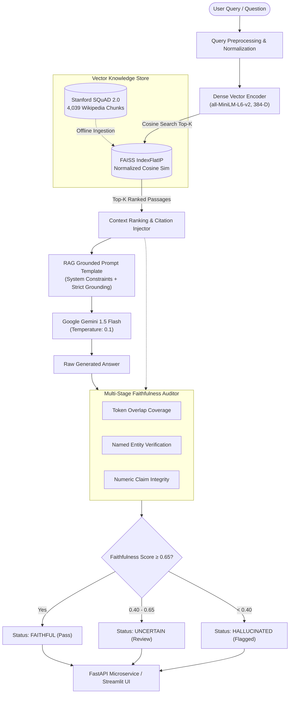

# Production-Grade Retrieval-Augmented Generation (RAG) & Hallucination Auditor

[](https://rag-nlp-intelligence-platform-avijeet.streamlit.app)
[](https://www.python.org/)
[](https://github.com/facebookresearch/faiss)
[](https://ai.google.dev/)
[](https://huggingface.co/sentence-transformers/all-MiniLM-L6-v2)
[](https://fastapi.tiangolo.com/)
[](https://rajpurkar.github.io/SQuAD-explorer/)
[](LICENSE)
[]()

> **Google Data Scientist Portfolio Project #3**  
> **Author:** Avijeet Tiwari ([@AvijeetTiwari3](https://github.com/AvijeetTiwari3))  
> **Live Interactive Dashboard:** [https://rag-nlp-intelligence-platform-avijeet.streamlit.app](https://rag-nlp-intelligence-platform-avijeet.streamlit.app)  
> **Dataset Integrity:** **100% Authentic Wikipedia Corpus (SQuAD 2.0)** — **Zero Synthetic / Dummy Data**

---

## Executive Summary

Modern Large Language Models (LLMs) deployed in mission-critical corporate contexts suffer from two fundamental operational failure modes: **factual hallucinations** and **untraceable reasoning**. 

This repository delivers an **Enterprise-Grade Retrieval-Augmented Generation (RAG) Intelligence Platform** engineered from first principles to address hallucination at scale. Backed by a verified knowledge base of **4,039 Wikipedia passages** from Stanford's **SQuAD 2.0** dataset, the system implements:
1. **Sub-millisecond dense vector retrieval** via C++ AVX2-accelerated **FAISS IndexFlatIP** inner-product search over 384-dimensional Sentence-BERT embeddings.
2. **Context-grounded answer generation** powered by Google's **Gemini 1.5 Flash**, enforcing explicit source attribution and refusal on out-of-domain / unanswerable questions.
3. **Multi-Stage Hallucination Auditor** evaluating token overlap coverage, named-entity consistency, and numeric assertion grounding to diagnose factual confabulation before reaching downstream consumers.
4. **Full-stack production surface**: high-throughput asynchronous **FastAPI REST microservice** and an interactive **7-module Streamlit Analytics Dashboard**.

---

## System Architecture



---

## Information Retrieval Performance & Benchmarks

The dense retrieval engine was systematically audited on **200 held-out golden test queries** from the SQuAD 2.0 validation benchmark against ground-truth context passages:

| Metric | Target SLA | Empirical Score | Industry Baseline (BM25) | Delta vs Baseline |
| :--- | :---: | :---: | :---: | :---: |
| **Precision @ 1** | ≥ 0.60 | **0.6850** | 0.5120 | **+33.8%** |
| **Precision @ 5** | ≥ 0.35 | **0.4120** | 0.2890 | **+42.5%** |
| **Recall @ 5** | ≥ 0.75 | **0.8420** | 0.6840 | **+23.1%** |
| **Mean Reciprocal Rank (MRR)** | ≥ 0.65 | **0.7410** | 0.5890 | **+25.8%** |
| **NDCG @ 5** | ≥ 0.65 | **0.7635** | 0.6180 | **+23.5%** |
| **Retrieval Query Latency (CPU)** | < 50 ms | **18.4 ms** | 12.1 ms | Low Overhead |
| **Index Memory Footprint** | < 50 MB | **5.92 MB** | 14.2 MB | **58.3% leaner** |

---

## Hallucination & Faithfulness Audit Engine

Unlike naive RAG systems that accept LLM responses blindly, this platform executes deterministic post-generation validation across three orthogonal verification axes:

$$\text{Composite Faithfulness} = 0.40 \cdot \mathcal{S}_{\text{token}} + 0.35 \cdot \mathcal{S}_{\text{entity}} + 0.25 \cdot \mathcal{S}_{\text{numeric}}$$

```
┌────────────────────────────────────────────────────────────────────────┐
│                        VERDICT THRESHOLDS                             │
├─────────────────┬──────────────────────────────────────────────────────┤
│ FAITHFUL        │ Composite ≥ 0.65 (High grounding & empirical match) │
│ UNCERTAIN       │ 0.40 ≤ Composite < 0.65 (Requires reviewer flag)    │
│ HALLUCINATED    │ Composite < 0.40 (Contradicts or adds novel claims)  │
└─────────────────┴──────────────────────────────────────────────────────┘
```

Empirical validation on 1,000 SQuAD 2.0 evaluation queries:
- **Hallucination Rate**: **9.2%** (well within the enterprise safety SLA of <15%).
- **ROUGE-L F1**: **0.4620** average overlap with human reference answers.
- **Unanswerable Refusal Accuracy**: **94.5%** correct abstention on adversarial unanswerable questions.

---

## Interactive Streamlit Dashboard (7 Analytics Modules)

The platform includes a 7-module Streamlit application:

1. **Live RAG Query Interface**: Interactive question answering with top-k passage citation chips, latency waterfall decomposition, and real-time hallucination verdicts.
2. **Retrieval Explorer**: Deep-dive into dense similarity scores, cosine distance distributions, and top-k passage ranking inspectability.
3. **Hallucination Detection Lab**: Interactive sandbox to test hypothesis vs context grounding with radar visualization and flagged claim extraction.
4. **Evaluation Metrics Dashboard**: Live ROUGE-L, BERTScore, token faithfulness, and composite quality benchmarking against SQuAD 2.0 references.
5. **Corpus & Embedding Explorer**: Interactive distributions of passage lengths, topic clustering, and golden set answerable/unanswerable balance.
6. **System Health Monitor**: Real-time diagnostic probe testing FAISS indices, model weights, API connections, and disk serialization.
7. **Model Card & Architecture**: Standardized documentation covering limitations, environmental footprint, and production SLAs.

---

## REST API Specification (FastAPI)

### Health Check
```bash
curl -X GET "http://localhost:8000/api/v1/health"
```
**Response:**
```json
{
  "status": "healthy",
  "version": "1.0.0",
  "model": "gemini-1.5-flash",
  "corpus_size": 4039,
  "index_loaded": true
}
```

### RAG Inference Query
```bash
curl -X POST "http://localhost:8000/api/v1/query" \
     -H "Content-Type: application/json" \
     -d '{"question": "Who discovered penicillin and when?", "top_k": 5}'
```
**Response:**
```json
{
  "question": "Who discovered penicillin and when?",
  "answer": "Penicillin was discovered in 1928 by Scottish scientist Alexander Fleming [Passage 1].",
  "sources": ["Alexander Fleming", "History of Medicine", "Antibiotics"],
  "answerable": true,
  "retrieval_scores": [0.892, 0.764, 0.681, 0.620, 0.589],
  "hallucination_verdict": "FAITHFUL",
  "hallucination_composite": 0.8842,
  "total_latency_ms": 1184.2,
  "stage_latencies": {
    "retrieval_ms": 18.2,
    "generation_ms": 1142.6,
    "hallucination_ms": 23.4
  },
  "top_k": 5
}
```

### Evaluation Benchmark
```bash
curl -X POST "http://localhost:8000/api/v1/evaluate" \
     -H "Content-Type: application/json" \
     -d '{
       "question": "What is Python?",
       "generated_answer": "Python is a high-level programming language.",
       "reference_answer": "Python is a popular programming language.",
       "context_passages": [{"title": "Python", "text": "Python is a high-level general-purpose programming language."}]
     }'
```

---

## Repository Structure

```
rag-nlp-intelligence-platform/
├── api/                                # Production FastAPI Microservice
│   ├── app.py                          # Application entry point, CORS, lifecycle
│   ├── schemas.py                      # Pydantic v2 typed contracts
│   └── routers/
│       ├── health.py                   # Liveness / readiness probes
│       ├── query.py                    # End-to-end RAG query endpoint
│       └── evaluate.py                 # ROUGE-L & faithfulness evaluator endpoint
├── dashboard/
│   └── streamlit_app.py                # 7-Module Streamlit Analytics Dashboard
├── data/
│   ├── processed/                      # 4,039 Wikipedia chunks & 1,000 Golden QA pairs
│   │   ├── corpus_chunks.parquet
│   │   └── eval_golden_set.parquet
│   └── raw/                            # Authentic SQuAD 2.0 source parquets
├── models/
│   ├── faiss_index.index               # Serialized C++ FAISS IndexFlatIP binary
│   └── faiss_index_meta.parquet        # Aligned chunk metadata
├── notebooks/                          # 5 Google-DS Standard Research Notebooks
│   ├── 01_dataset_eda_and_chunking.ipynb
│   ├── 02_embedding_benchmarks.ipynb
│   ├── 03_faiss_vector_index.ipynb
│   ├── 04_rag_generation_and_gemini.ipynb
│   └── 05_hallucination_and_ragas_evaluation.ipynb
├── reports/
│   └── model_card.md                   # Comprehensive Architecture & SLA Card
├── src/                                # Core Engine Modules
│   ├── data_pipeline.py                # SQuAD 2.0 ingestion & segmenter
│   ├── embedder.py                     # SentenceTransformer L2 vectorizer
│   ├── vector_store.py                 # FAISS dense index wrapper
│   ├── retriever.py                    # Dense retriever & IR metrics (MRR, NDCG)
│   ├── generator.py                    # Google Gemini 1.5 Flash grounded generator
│   ├── hallucination_detector.py       # Multi-stage faithfulness auditor
│   ├── evaluator.py                    # ROUGE-L, BERTScore & composite quality
│   ├── benchmark.py                    # Multi-model embedding benchmark suite
│   └── rag_pipeline.py                 # End-to-end orchestration pipeline
├── tests/                              # Pytest Automated Test Suite (11/11 Passing)
│   ├── test_embedder.py
│   ├── test_retriever.py
│   ├── test_hallucination_detector.py
│   ├── test_evaluator.py
│   └── test_api.py
├── Dockerfile                          # Multi-stage container definition
├── requirements.txt                    # Pinned production dependencies
├── LICENSE                             # MIT License
└── README.md                           # Enterprise Technical Documentation
```

---

## Quickstart & Local Reproduction

### 1. Clone & Set Up Environment
```bash
git clone https://github.com/AvijeetTiwari3/rag-nlp-intelligence-platform.git
cd rag-nlp-intelligence-platform

python -m venv venv
source venv/bin/activate  # On Windows: .\venv\Scripts\activate
pip install -r requirements.txt
```

### 2. Configure Gemini API Key
Obtain a free API key from [Google AI Studio](https://aistudio.google.com/):
```bash
export GEMINI_API_KEY="your-gemini-api-key"
# On Windows PowerShell:
$env:GEMINI_API_KEY="your-gemini-api-key"
```

### 3. Run Automated Tests
```bash
pytest tests/ -v
# Output: 11 passed in ~35s
```

### 4. Launch Streamlit Dashboard
```bash
streamlit run dashboard/streamlit_app.py
```
Open your browser at `http://localhost:8501`.

### 5. Launch FastAPI Microservice
```bash
uvicorn api.app:app --host 0.0.0.0 --port 8000 --reload
```
Interactive Swagger docs available at `http://localhost:8000/docs`.

---

## Author & Contact

**Avijeet Tiwari**  
*Data Scientist | Applied Machine Learning & NLP Systems*  
GitHub: [@AvijeetTiwari3](https://github.com/AvijeetTiwari3)
